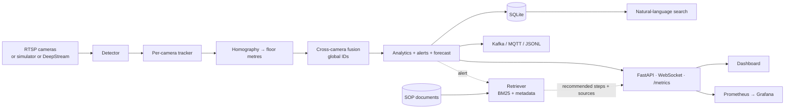

# ✈ AeroFlow

**Multi-camera passenger flow, queue analytics and safety alerts for airports - contactless and privacy-preserving.**

[](https://github.com/YOUR_USERNAME/aeroflow/actions)
 

AeroFlow watches a terminal with several cameras, follows each (anonymous) person across camera views,
places everyone on one top-down floor plan, and turns that into operational answers:

> *"Security queue: 24 people, ~2.4 min wait, forecast 4.1 min in 10 min → open another lane."*
> *"Unattended bag in Check-in Hall - owner left 35 s ago."*

No faces, no identities, no raw video stored. It runs **on a laptop CPU with a built-in simulator**
(no GPU, camera, dataset or API key needed) and has optional paths for real RTSP cameras, YOLO/TensorRT
and NVIDIA DeepStream.

<!-- After adding docs/img/dashboard.png, replace this line with:   -->

## Features

| Area | What you get |
|---|---|
| **Vision** | Per-camera tracking (velocity + appearance) · homography calibration · **cross-camera Re-ID/fusion on the floor plane** |
| **Operations** | Live occupancy & density per zone · **queue wait estimate** · **wait forecast (10 min ahead)** · dwell times · **heatmap** · "open another lane" suggestion |
| **Safety & security** | **Unattended-bag detection** (owner-aware) · **fall detection** · restricted-area entry · crowd density · capacity · loitering |
| **AI search** | Ask *"when was the Security Queue wait longest?"* - rule parser by default, optional **Gemini free tier** |
| **Incident summaries** | Human-readable text for every alert (templated, no external service) |
| **RAG over SOPs** | Each alert is enriched with **recommended steps retrieved from your SOP documents, with cited sources**; ask *"what do we do if someone collapses?"* and get an answer grounded only in those documents. BM25 + metadata (no downloads); optional local embeddings; optional Gemini free tier |
| **Privacy** | No face recognition · head-blur for previews · counts-only storage · enforced retention (`aeroflow purge`) |
| **Platform** | FastAPI REST + WebSocket · live dashboard · Prometheus `/metrics` + Grafana · Kafka / MQTT(Solace) events · Docker · CI |
| **GPU path** | YOLO → ONNX → TensorRT FP16/INT8 benchmark script · DeepStream templates · `Engine.process()` integration point |

## Quick start (no GPU, no keys)

```bash
git clone https://github.com/YOUR_USERNAME/aeroflow.git && cd aeroflow
python -m venv .venv
source .venv/bin/activate          # Windows PowerShell:  .venv\Scripts\Activate.ps1
pip install -e ".[dev]"

aeroflow run                      # then open http://127.0.0.1:8000
```

> **Windows:** use PowerShell. If activation is blocked, run `Set-ExecutionPolicy -Scope CurrentUser RemoteSigned` once.

The simulator spawns passengers who go check-in → security queue → gate, with bags, and scripts three
incidents (abandoned bag ~4 min, intruder ~5 min, fall ~7 min of simulated time; 4× speed by default).

```bash
aeroflow eval --seconds 600       # identity-consistency + alert evaluation vs ground truth
aeroflow search "how many people are in the security queue"
aeroflow sop "what do we do if someone collapses"   # RAG over sops/
pytest -q                         # 39 tests
```

**Try in the dashboard** (`http://127.0.0.1:8000`): watch the queue forecast update, tick *Heatmap*, then use the *Ask*
box - **Data** mode (*"when was the security queue wait longest?"*) or **Procedures** mode (*"what do we do if someone
collapses?"*). Press *Esc* or *Clear* to reset the box.

### Docker (with Prometheus + Grafana)

```bash
docker compose up --build
# Dashboard http://localhost:8000 · Prometheus :9090 · Grafana http://localhost:3000 (admin/admin)
```

## Architecture



Details: [docs/architecture.md](docs/architecture.md) · [docs/security.md](docs/security.md) ·
[docs/evaluation.md](docs/evaluation.md) · [ADRs](docs/adr) · [post-mortem](docs/postmortems/2026-10-18-identity-and-bag-alerts.md)

## Using real cameras

1. `pip install -e ".[vision]"` (Ultralytics YOLO; use a CUDA build of PyTorch for GPU).
2. **Calibrate each camera**: in `configs/default.yaml` list ≥4 `image_points` (pixels) with the matching
   `floor_points` (metres) - e.g. floor tile corners - and set `source: rtsp://...`.
3. Draw your `zones` (polygons in floor metres) with capacities and wait limits.
4. `aeroflow run --source rtsp --config configs/mysite.yaml`

Weights can be `.pt`, `.onnx` or a TensorRT `.engine`. Benchmark them with
`python benchmarks/benchmark_inference.py` (see [docs/evaluation.md](docs/evaluation.md) to record results).
For many streams use the DeepStream path ([deepstream/](deepstream/README.md)).

## API

| Endpoint | Description |
|---|---|
| `GET /` | Live dashboard (floor map, zones, alerts, heatmap toggle, search box) |
| `GET /api/state` · `WS /ws` | Current tracks, zone stats, active alerts, forecast |
| `GET /api/layout` | Floor size, zone polygons, camera coverage |
| `GET /api/zones/{id}/history?minutes=` | Stored zone time series |
| `GET /api/alerts?type=&zone=` | Alert history with summaries |
| `GET /api/heatmap` · `GET /api/forecast` | Dwell heatmap grid · queue forecasts |
| `GET /api/search?q=` | Natural-language question over stored data |
| `GET /api/sop/ask?q=` · `GET /api/sop/search?q=&k=` | RAG: grounded answer with sources · raw retrieved SOP passages |
| `GET /metrics` · `GET /health` | Prometheus metrics · liveness |

Interactive docs at `/docs` (OpenAPI).

## RAG over SOPs

Add your procedures as markdown files in `sops/` (six **sample** SOPs are included; replace them with real
ones). Front-matter links a document to alert types, and `##` sections become retrievable chunks:

```markdown
---
title: Unattended Baggage
alert_types: [unattended_bag]
---
## Immediate actions
1. Do not touch, move or open the bag.
```

When an alert fires, the top sections are attached as `recommended` (steps + cited sources) and shown on
the dashboard. Output is **advisory only** and never triggers actions. If nothing relevant is found the
system says so. Retrieval quality on a labelled question set is reported in
[docs/evaluation.md](docs/evaluation.md); `backend: hybrid` adds local sentence-transformers embeddings.

## Free-tier / API keys

**None are required.** The only optional integration is natural-language parsing with Google's Gemini
**free tier**: copy `.env.example`, set `GEMINI_API_KEY` (free from Google AI Studio). Only the question
text and zone names are sent; if the key is missing or a call fails, the built-in rule parser is used.
Model names on the free tier change; set `GEMINI_MODEL` to one currently listed in AI Studio.
Solace: the free PubSub+ Standard Docker image accepts the MQTT backend (`events.backend: mqtt`).

## What has been verified (and what hasn't)

| Component | Status |
|---|---|
| Tracking, fusion, analytics, alerts, forecasting, store, API, dashboard backend, NL rules | ✅ Unit/integration tests + simulator evaluation (run in CI on Linux and Windows) |
| Identity quality on the simulator | ✅ ID consistency 0.88-0.95 over 4 seeds, all scripted incidents detected once, 0 false incident alerts |
| Dashboard front-end | ✅ Manually verified in Chrome on Windows (live map, zones, alerts with SOP steps, Ask box); no automated browser tests |
| YOLO detector, RTSP source, HSV appearance embedding | ⚠️ Written but **not run** against real cameras/weights in CI |
| TensorRT / ONNX benchmark script | ⚠️ Written, **not run** (needs GPU) - results table in `docs/evaluation.md` is intentionally blank |
| DeepStream configs | ⚠️ Templates only; adjust for your DeepStream version/parser |
| RAG with default BM25 backend (alerts → SOP steps, `/api/sop/*`, CLI) | ✅ Tested incl. retrieval benchmark; SOPs are **samples**, corpus is tiny |
| RAG `hybrid` embeddings backend, Gemini-phrased answers | ⚠️ Written, **not run** (model download / key unavailable here) |
| Kafka / MQTT backends, Gemini query parsing, Docker build | ⚠️ Not exercised here (no broker, key, or Docker daemon) |
| **Real-world accuracy** | ❌ Not measured. Simulator results show the logic works, not field accuracy - validate on WILDTRACK / MMPTRACK |

## Project layout

```
src/aeroflow/   simulation · tracking · fusion · analytics · forecast · nlsearch · rag · privacy · store · events · engine · api · cli
sops/           sample SOP documents used by RAG
configs/        default site config, Prometheus, Grafana provisioning + dashboard
deepstream/     GPU pipeline templates          benchmarks/   TensorRT/ONNX benchmark
docs/           architecture, security, evaluation, ADRs, post-mortem
tests/          pytest suite                    .github/      CI
```

## Roadmap

- [ ] Evaluate on WILDTRACK / MMPTRACK; report IDF1/MOTA
- [ ] Learned Re-ID (OSNet → TensorRT) replacing the colour histogram
- [ ] DeepStream pad-probe adapter feeding `Engine.process`
- [ ] Isaac Sim / Omniverse synthetic data + digital-twin "what if we add 2 lanes?" simulation
- [ ] Vector store + learned embeddings for larger SOP corpora; incident-history retrieval
- [ ] VLM snapshot captions for alerts (anonymised frames only)
- [ ] Auth + TLS, Postgres/Timescale backend, Helm chart

## License

MIT - see [LICENSE](LICENSE).
