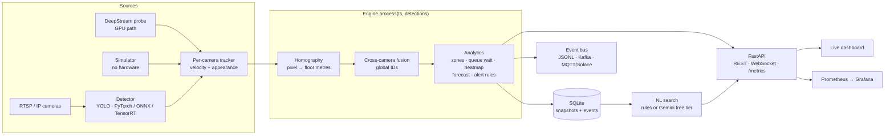

# Architecture

## Stages

| Stage | Module | Notes |
|---|---|---|
| Detection | `sources.py` | YOLO (`.pt`, `.onnx` or TensorRT `.engine`). COCO person, backpack, handbag, suitcase → `person` / `bag`. |
| Local tracking | `tracking.py` | Greedy association on foot-point distance with constant-velocity prediction, a gate that widens after misses, and an appearance term. |
| Calibration | `geometry.py` | Each camera has a homography from ≥4 image↔floor point pairs. Foot point → floor metres. |
| Fusion (Re-ID) | `fusion.py` | Local tracks → global IDs. Cost = floor distance (gated by time unseen) + appearance. One global ID may be seen by many cameras, but by at most one local track per camera. |
| Analytics | `analytics.py` | Occupancy, density, dwell, throughput, queue wait (count ÷ exit rate), heatmap, Holt forecast, alert rules. |
| Procedure RAG | `rag.py` | SOP markdown → section chunks → BM25 + synonyms + alert-type metadata boost → steps with cited sources attached to each alert; grounded Q&A. Advisory only. |
| Persistence | `store.py` | SQLite; retention via `purge`. Only counts and alerts are stored. |
| Delivery | `api.py`, `events.py`, `metrics.py` | REST/WebSocket, event bus, Prometheus. |

## Design choices that matter

* **Fusion on the floor plane, not in image space.** Distances in metres mean the same thing in every
  camera, which makes handoff between overlapping views a simple gated assignment.
* **Queue wait = people ÷ throughput (Little's law)**, trusted only after a minimum number of exits.
  Before that we fall back to the longest current dwell instead of printing a wild number.
* **Unattended bag = owner left, not "nobody nearby".** Busy halls always have strangers within a few
  metres, so the rule binds each bag to the person carrying it and alerts when that person is gone.
  See [the post-mortem](postmortems/2026-10-18-identity-and-bag-alerts.md).
* **Alerts are stateful**: raised once, active while the condition holds, hysteresis on thresholds,
  cooldown on flapping "soft" alerts, and security-critical alerts latch until the cause changes.
* **One integration point**: `Engine.process(ts, detections)`. Anything that can produce `Detection`s
  (YOLO loop, DeepStream probe, replayed recordings) plugs in unchanged.

## Scaling to production

* GPU path: DeepStream `nvstreammux` batching + `nvinfer` + `nvtracker`; see `deepstream/`.
* Run one `Engine` per terminal zone; publish to Kafka/Solace; consume in separate microservices.
* Replace SQLite with Postgres/TimescaleDB for multi-node deployments.
* Replace the colour-histogram embedding with a learned Re-ID model (e.g. OSNet) exported to TensorRT.
